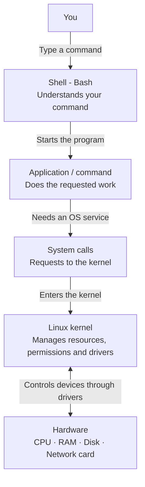

# Linux Architecture and DevOps Quickstart

The easiest way to understand Linux is: **you ask a program to do something → the program asks the kernel → the kernel manages the hardware.**

When you **type a command**, the shell helps start that program.

## Contents

- [1. Request flow when you type a command](#1-request-flow-when-you-type-a-command)
- [2. What each part does](#2-what-each-part-does)
- [3. Example: reading a file](#3-example-reading-a-file)
- [4. Where the shell fits](#4-where-the-shell-fits)
- [5. Memory trick](#5-memory-trick)

- [6. Why Linux and where it came from](#6-why-linux-and-where-it-came-from)
- [7. Distributions and package families](#7-distributions-and-package-families)
- [8. Important directories](#8-important-directories)
- [9. Terminal basics and paths](#9-terminal-basics-and-paths)
- [10. Create, copy, move and delete](#10-create-copy-move-and-delete)
- [11. Listing files, file types and links](#11-listing-files-file-types-and-links)
- [12. Edit files with Vim](#12-edit-files-with-vim)
- [13. Read, search and filter text](#13-read-search-and-filter-text)
- [14. Redirect output and connect commands](#14-redirect-output-and-connect-commands)
- [15. Find files and directories](#15-find-files-and-directories)
- [16. Users, groups and account files](#16-users-groups-and-account-files)
- [17. File ownership and permissions](#17-file-ownership-and-permissions)
- [18. Sudo and switching users](#18-sudo-and-switching-users)
- [19. Install and manage software](#19-install-and-manage-software)
- [20. Remote login with SSH](#20-remote-login-with-ssh)
- [21. Transfer files](#21-transfer-files)
- [22. Disk usage and mounting](#22-disk-usage-and-mounting)
- [23. Manage services](#23-manage-services)
- [24. Archives and compression](#24-archives-and-compression)
- [25. Processes and jobs](#25-processes-and-jobs)
- [26. System information](#26-system-information)
- [27. Hardware information](#27-hardware-information)
- [28. Performance and statistics](#28-performance-and-statistics)
- [29. One small practice exercise](#29-one-small-practice-exercise)
- [30. Corrections and reference notes](#30-corrections-and-reference-notes)

---

## 1. Request flow when you type a command



**Read the arrows downward for the request.** Data and results return to the program, which can then display output in your terminal.

> The diagram uses Mermaid. A Markdown viewer with Mermaid support displays it as a diagram; other viewers show its source code.

## 2. What each part does

| Part | Easy meaning | Example |
|---|---|---|
| **Application** | A program that performs a task. | Python, Chrome, Nginx, `cat`. |
| **Shell** | A command interpreter: reads what you type and runs commands. | Bash runs `python app.py`. |
| **System calls** | The interface programs use to request kernel services. | “Open this file,” “read this data,” or “send this data.” |
| **Kernel** | The core of Linux: manages CPU time, memory, processes, devices and access checks. | Checks whether your program may read a file. |
| **Device drivers** | Parts of the kernel, often loadable modules, that communicate with particular devices. | Disk driver or network card driver. |
| **Hardware** | The physical components that execute work and store or transfer data. | CPU, RAM, SSD, network card. |

### Hardware in simple words

- **CPU:** executes instructions.
- **RAM:** holds data that programs are currently working with.
- **Disk / SSD:** stores files.
- **Network card:** transfers data over a network.

## 3. Example: reading a file

You type:

```bash
cat notes.txt
```

1. **Bash** reads the command and starts the `cat` program.
2. **`cat`** asks the kernel to open and read `notes.txt`, using system calls.
3. **The kernel** checks permissions and gets the contents from memory cache or storage, using a driver when needed.
4. **`cat`** receives the contents and requests that they be written to its output.
5. **Your terminal** displays the text.

## 4. Where the shell fits

**The shell is itself an application.** Programs do not need to send every request through it.

After Bash starts Python with `python app.py`, Python makes its own requests to the kernel. A graphical application such as Chrome also uses kernel services without sending its requests through Bash.

The shell helps launch commands. It is not a compulsory middle layer for every application request.

## 5. Memory trick

| Part | Remember it as |
|---|---|
| Shell | Command interpreter |
| Application | Worker |
| Kernel | Resource manager |
| Hardware | Equipment |

---

# Practical DevOps Notes

The sections below reorganize **Linux Quickstart V5** into the same easy learning style: **what it is → what it does → command → practical use**. The architecture explanation above stays as the starting point. Screenshot examples are converted into searchable text and code blocks.

**How to use these notes**

- Use a practice VM for exercises that change users, packages, services or disks.
- Run commands without the terminal prompt (`$` or `#`). Lines starting with `#` inside code blocks are comments.
- `sudo` runs an authorized command with elevated privileges. Replace example usernames, paths and IP addresses with your own.
- Commands are case-sensitive: `Root` and `root` are different.
- Ubuntu examples use APT. RHEL-family examples use DNF; YUM commands are retained for older course material.
- Some utilities need installation and some commands vary by distribution or version. Use `man command` or `command --help` for your installed version.

## 6. Why Linux and where it came from

### 6.1 What is open source?

Open-source software makes its source code available under a license that allows use, study, modification and redistribution subject to that license's terms. It does not mean that every product or support service is free of charge.

The PDF introduces the Free Software Foundation's four freedoms:

1. Run the program for any purpose.
2. Study how it works and change it.
3. Redistribute copies.
4. Distribute your modified versions.

Different open-source licenses have different conditions.

### 6.2 Where Linux came from

| Milestone | Easy explanation |
|---|---|
| GNU project began in 1983; Free Software Foundation established in 1985 | GNU developed free Unix-like tools and utilities. The PDF groups these under a 1984 milestone; the dates are corrected here. |
| Linus Torvalds began Linux in 1991 | Linux provided a Unix-like kernel; it adopted the GNU GPL in 1992. |
| Kernel + utilities + other software | Distributions package the components into a usable operating system for a particular audience. |

**Remember:** Linux technically names the kernel. Ubuntu and similar distributions provide a complete operating system around it.

### 6.3 Why Linux matters in DevOps

| Benefit | Practical use |
|---|---|
| Open source | Inspect behavior and use community tools. |
| Community and commercial support | Find documentation, troubleshooting help and support services. |
| Customizable | Install just the components a server needs. |
| Common on servers | Practice skills used on cloud VMs and application servers. |
| Strong automation tools | Repeat setup and administration with commands and scripts. |
| Broad DevOps tooling | Run tools such as Git, build agents and web servers. Many also support other operating systems. |
| Security controls | Use permissions, updates and limited privileges; security still depends on configuration and maintenance. |

### 6.4 Linux design principles

- **Many resources use a file-like interface:** ordinary files, devices and some kernel information can be accessed using file operations. “Everything is a file” is a useful simplification.
- **Small tools with focused jobs:** one tool searches text; another sorts it.
- **Combine tools:** pipes connect one program's output to another program's input.
- **Automation-friendly interfaces:** commands can run without an interactive graphical screen. Graphical applications still exist.
- **Text configuration is common:** many services keep settings in editable text files.

**Example:** find account entries containing `root`, then page through the result:

```bash
grep root /etc/passwd | less
```

## 7. Distributions and package families

**A distribution is a packaged Linux operating system:** kernel + utilities + package manager + defaults.

### 7.1 Distributions named in the PDF

| Typical use | Examples |
|---|---|
| Desktop | Ubuntu, Linux Mint, Arch Linux, Fedora, Debian, openSUSE |
| Server | Red Hat Enterprise Linux (RHEL), Ubuntu Server, CentOS, SUSE Linux Enterprise Server |

These are examples, not a current popularity ranking. Some distributions serve both desktop and server needs.

**Version note:** the PDF is from 2021 and uses CentOS Linux 7/8 and Ubuntu 20 examples. CentOS Linux 7 reached end of life on June 30, 2024; CentOS Linux 8 on December 31, 2021. CentOS Stream is a different release model. Keep old commands for understanding your course, and check your VM's actual release before following package instructions.

### 7.2 DEB versus RPM

| Question | Debian / Ubuntu family | RHEL / Fedora family |
|---|---|---|
| Package format | `.deb` | `.rpm` |
| Low-level tool | `dpkg` | `rpm` |
| Higher-level tool | APT | DNF; YUM in older material |
| Apache package/service | `apache2` | `httpd` |
| Repository configuration | `/etc/apt/sources.list.d/` and, on older setups, `/etc/apt/sources.list` | `/etc/yum.repos.d/` |

Both formats package software and metadata. The important beginner difference is **which format and package manager your distribution uses**. Packages are not automatically interchangeable.

**Examples from the PDF:**

```bash
# Ubuntu: local Google Chrome package
sudo dpkg -i google-chrome-stable_current_amd64.deb
```

```bash
# Historical RPM filename from the PDF; use your actual downloaded filename
sudo rpm -ivh google-chrome-stable-57.0.2987.133-1.x86_64.rpm
```

The long version number is part of an example filename, not a version recommendation. APT/DNF can resolve and fetch dependencies; installing directly with `dpkg`/`rpm` can leave missing dependencies.

## 8. Important directories

**Think of Linux as a company building. Each directory is a room with a different purpose.** You do not need to memorize every room at once.

### 8.1 Start with these five

| Directory | Think of it as | Simple example |
|---|---|---|
| `/bin` | **Toolbox:** programs you run. | `ls` lists files; `cp` copies them. |
| `/etc` | **Settings room:** configuration files. | SSH settings tell the SSH server how to behave. |
| `/var/log` | **Daily diary:** records of what happened. | Investigate why a service failed. |
| `/home/imran` | **Your personal room:** your own files. | Projects, downloads and practice notes. Replace `imran` with your username. |
| `/tmp` | **Temporary desk:** short-lived files. | A program stores a temporary file while working. Files may be cleaned automatically. |

**Memory trick:** tools = `/bin`; settings = `/etc`; logs = `/var/log`; temporary = `/tmp`; personal files = `/home`.

### 8.2 One service connects the idea

Imagine the SSH server on your Linux VM:

1. **Program:** the software that accepts SSH connections lives in a program directory, commonly `/usr/sbin/sshd`.
2. **Settings:** files under `/etc/ssh/` control how it behaves; a main configuration file is commonly `/etc/ssh/sshd_config`.
3. **Activity records:** connection events and errors are often recorded under `/var/log/` or in the system journal, depending on the distribution.

**Program → Settings → Activity records.**

A program file, its settings and its logs serve different purposes, so Linux keeps them in different locations.

### 8.3 Why are there so many `bin` directories?

`bin` is short for **binaries**: executable programs. Executables can also be scripts.

| Directory | Main idea | Easy way to remember |
|---|---|---|
| `/bin` | Historically, essential commands needed for basic system operation. | Basic toolbox. |
| `/usr/bin` | Most general commands supplied through the distribution's package layout. | Main toolbox. |
| `/usr/local/bin` | Commands installed locally by an administrator outside the normal distribution package layout. | Locally added toolbox. |
| `/sbin` | Historically, essential system administration programs. | Basic administration toolbox. |
| `/usr/sbin` | More system administration programs supplied through the distribution's package layout. | Main administration toolbox. |
| `/usr/local/sbin` | Locally installed system administration programs. | Locally added administration toolbox. |

**Modern Linux simplifies this:** on many distributions, `/bin` links to `/usr/bin`, and `/sbin` links to `/usr/sbin`. Two names can therefore lead to the same directory. A similar merge often applies to `/lib` and `/usr/lib`.

**Important:** `/usr` is not your personal user folder. Your personal folder is usually `/home/yourname`. Also, a program being in `sbin` does not itself decide whether you can run it; permissions and the operation being requested matter.

To see where your system finds a command:

```bash
command -v ls
command -v cp
```

These print command paths. Paths can differ between distributions.

### 8.4 Root directory versus root user's home

| Path | Meaning | Analogy |
|---|---|---|
| `/` | Filesystem root: the starting point of the directory tree. | The whole building. |
| `/root` | Home directory of the root administrator account. | The administrator's personal room. |
| `/home/username` | A regular user's home directory. | That user's personal room. |

`/` and `/root` are different places.

### 8.5 Boot files, changing data and served data

| Directory | Easy meaning | Example |
|---|---|---|
| `/boot` | Files needed to **start Linux**. | Kernel images and bootloader files. |
| `/var` | Data that **changes while the system runs**. | Logs, caches, queued work such as mail/print spool files, and service state. |
| `/var/log` | The log section inside `/var`. | Records used to investigate errors and activity. |
| `/srv` | Data this machine **serves to other machines**. | Files offered by a file server, if configured there. Not every service uses this directory. |

**Remember:** `/var` is the larger category; `/var/log` is one directory inside it.

### 8.6 `/dev`, `/proc` and `/sys`: three different jobs

These are special interfaces rather than ordinary folders of saved documents.

| Directory | Think of it as | Example |
|---|---|---|
| `/dev` | **Device access points:** interfaces through which programs interact with devices. | `/dev/sda` represents a disk on some systems; `/dev/tty` relates to a terminal. Device names vary. |
| `/proc` | **Live status board:** information about processes and the kernel. | `/proc/cpuinfo` shows CPU information; `/proc/1234` contains information about PID 1234 if that process exists. |
| `/sys` | **Device information and control panel:** devices, drivers and kernel attributes. | `/sys/class/net/` exposes information about network interfaces. Some attributes are writable with appropriate privileges. |

**Easy distinction:**

- `/dev`: access the device interface.
- `/proc`: inspect process/kernel status.
- `/sys`: inspect device/kernel attributes and supported controls.

Read-only practice:

```bash
head /proc/cpuinfo
ls /sys/class/net/
ls /dev/tty
```

**What you see:** CPU information, network interface names and a terminal device path. `/proc` and `/sys` expose information dynamically; their entries are not ordinary persistent files on disk.

### 8.7 Libraries and attached storage

| Directory | Easy meaning | Example use |
|---|---|---|
| `/lib`, `/usr/lib`, `/usr/local/lib` | **Shared support code** used by programs; exact layout varies. | A program uses a library instead of carrying its own copy of every function. |
| `/media` | Often where desktop systems attach removable-media filesystems. | Access a mounted USB drive. |
| `/mnt` | A conventional place for temporary filesystem mounts. | An administrator mounts a practice disk for inspection. |

**Mounting** means making a filesystem accessible at a directory. Actual mount locations depend on system configuration.

### 8.8 What to remember today

Focus first on **where your files are, where commands are, where settings are and where logs are**:

| Your question | First place to think about |
|---|---|
| Where are my projects and notes? | `/home/yourname` |
| Where is an installed command? | `/usr/bin` or another program directory; check with `command -v`. |
| Where do I change service settings? | `/etc` |
| Where do I investigate errors? | `/var/log` or the system journal |
| Where can temporary files go? | `/tmp` |

## 9. Terminal basics and paths

### 9.1 Terminal versus shell

- **Terminal:** the window or session where you type and see output.
- **Shell:** the program, such as Bash, that interprets commands inside the terminal.

Open the Terminal application on a desktop, or connect to your server using SSH.

### 9.2 Know where you are

```bash
pwd
```

**What it does:** prints the current working directory.

**Example output:**

```text
/home/imran
```

```bash
whoami
```

**What it does:** prints your effective username.

### 9.3 Absolute versus relative paths

| Type | Meaning | Example |
|---|---|---|
| Absolute | Starts at filesystem root `/` | `/home/imran/linux-practices` |
| Relative | Starts at your current directory | `linux-practices` |

If you are already in `/home/imran`, these reach the same folder:

```bash
cd /home/imran/linux-practices
```

```bash
cd linux-practices
```

Other absolute-path examples in the PDF are `/var/ftp/pub`, `/etc/samba.smb.conf` and `/boot/grub/grub.conf`. These illustrate paths; those exact files may not exist on your distribution. Samba configuration is commonly `/etc/samba/smb.conf`.

### 9.4 Move between directories

| Command | What it does |
|---|---|
| `cd /etc` | Go to `/etc`. |
| `cd ..` | Go up one directory. |
| `cd` or `cd ~` | Go to your home directory. |
| `cd -` | Go to the previous working directory. |
| `pwd` | Confirm your location. |

`.` means the current directory; `..` means the parent directory; `~` means your home directory.

## 10. Create, copy, move and delete

### 10.1 Create a practice directory

```bash
mkdir -p ~/linux-practices
cd ~/linux-practices
mkdir devopsdir testdir vpdir
ls
```

**What it does:** creates a practice workspace and three subdirectories. `-p` creates missing parents and accepts an existing directory.

### 10.2 Create empty files

```bash
touch file1 file2 file3 file4
ls
```

`touch` creates a missing file; if the file exists, it updates timestamps rather than clearing its contents.

### 10.3 Create folders using either kind of path

```bash
mkdir -p ~/linux-practices/devopsdir/ansible
mkdir -p devopsdir/aws
```

The first uses a home-relative path expanded by the shell into an absolute path. The second is relative to your current working directory.

### 10.4 Copy files and directories

```bash
cp file1 file2 testdir/
```

**Use case:** put copies of two files into `testdir`.

```bash
cp -r testdir vpdir/
```

**Use case:** copy a directory and its contents. `-r` means recursive.

### 10.5 Move or rename

```bash
mv file3 file4 vpdir/
```

**What it does:** moves the files; their original locations disappear.

```bash
mv file1 renamed-file1.txt
```

**What it does:** renames a file.

### 10.6 Delete

These commands delete the practice items named below:

```bash
rm file2
rm -r testdir
```

`rm` removes files; `rm -r` removes directories and their contents. Check the path first; these commands do not move items to a desktop recycle bin.

For an empty directory only:

```bash
rmdir empty-directory
```

## 11. Listing files, file types and links

### 11.1 Useful `ls` options

| Command | What it shows |
|---|---|
| `ls` | Names of visible entries. |
| `ls -l` | Long listing: type, permissions, ownership, size and time. |
| `ls -a` | Hidden entries too, including names beginning with `.`. |
| `ls -F` | Type indicators, such as `/` after directories. |
| `ls -g` | Long listing without the owner column. |
| `ls -i` | Inode numbers. |
| `ls -m` | Comma-separated names. |
| `ls -n` | Numeric UID/GID in a long listing. |
| `ls -r` | Reverse the sort order. |
| `ls -R` | Recursively list subdirectories. |
| `ls -t` | Sort by modification time, newest first. |
| `ls -lh` | Long listing with readable sizes. |

Options can be combined. Example:

```bash
ls -lah ~/linux-practices
```

### 11.2 File types

The first character of a long listing indicates the type:

| Character | Type | Meaning |
|---|---|---|
| `-` | Regular file | Text, data or executable file. |
| `d` | Directory | Contains names of files/directories. |
| `l` | Symbolic link | A path pointing to another path. |
| `c` | Character device | Device interface with character/stream-style access. |
| `b` | Block device | Device interface for block storage, such as a disk. |
| `s` | Socket | Communication endpoint, often between local processes. |
| `p` | Named pipe / FIFO | Special file for passing data between processes. |

### 11.3 Symbolic links

A symbolic link is **similar to a shortcut**, but programs can follow it as a filesystem path.

```bash
cd ~/linux-practices
ln -s /var/log logs
ls -l logs
```

**What it does:** creates `logs`, pointing to `/var/log`. It does not copy the directory. Permissions on the target still apply.

## 12. Edit files with Vim

**Vim is a terminal text editor.** The name means **Vi IMproved**; `vi` is the older visual editor. Other editors named in the PDF include Emacs and gedit.

### 12.1 Install Vim

Ubuntu:

```bash
sudo apt update
sudo apt install vim
```

RHEL family:

```bash
sudo dnf install vim
```

Older course command:

```bash
sudo yum install vim
```

### 12.2 Your first edit

```bash
vim firstfile.txt
```

1. Vim opens in **Normal mode** (called command mode in the PDF).
2. Press `i` to enter **Insert mode**.
3. Type a few lines.
4. Press `Esc` to return to Normal mode.
5. Type `:wq`, then press `Enter` to save and quit.
6. Read the result:

```bash
cat firstfile.txt
```

### 12.3 Three modes to remember

| Mode | What you do | How to enter |
|---|---|---|
| Normal | Navigate, copy, delete and undo | Press `Esc`. |
| Insert | Type/edit text | Press `i` from Normal mode. |
| Command-line | Save, quit, search or enter commands | Press `:` for Ex commands; `/` starts a search. |

### 12.4 Normal-mode shortcuts

| Keys | Meaning |
|---|---|
| `gg` | Go to the first line. |
| `G` | Go to the last line. |
| `w`, `b` | Move forward/backward by words. |
| `5w`, `5b` | Move forward/backward five words; replace `5` with a count. |
| `u` | Undo the last change. |
| `U` | Undo the latest changes on the current line. |
| `Ctrl+R` | Redo an undone change. |
| `yy` | Copy/yank a line; `V` then `y` is another way. |
| `5yy` | Copy five lines. |
| `p` | Put/paste after the cursor; linewise text goes below. |
| `P` | Put/paste before the cursor; linewise text goes above. |
| `dw` | Delete to the next word boundary. |
| `x` | Delete the character under the cursor. |
| `X` | Delete the character before the cursor. |
| `dd` | Delete a line. |
| `5dd` | Delete five lines. |
| `/word` then `Enter` | Search forward for `word`. |
| `n`, `N` | Next/previous search match. |

### 12.5 Save, quit and line numbers

Press `Esc` before entering these commands; press `Enter` afterward.

| Command | Meaning |
|---|---|
| `:w` | Save. |
| `:q` | Quit; refuses if there are unsaved changes. |
| `:q!` | Quit and discard unsaved changes. |
| `:wq` | Save and quit. |
| `:x` | Save if changed, then quit. |
| `:w!` | Force a write where possible; does not bypass OS permissions. |
| `:wq!` | Force write and quit where possible. |
| `:20` | Go to line 20; use any line number. |
| `:set number` or `:set nu` | Show line numbers. |
| `:set nonumber` or `:set nonu` | Hide line numbers. |
| `:X` | Set/change the file encryption key if supported; an empty key removes encryption on the next write. This differs from lowercase `:x`. |

**DevOps use:** edit a configuration file, save it, then reload the relevant service if appropriate.

## 13. Read, search and filter text

### 13.1 View file contents

| Command | What it does |
|---|---|
| `cat /etc/passwd` | Print the whole file. |
| `less /etc/passwd` | View with scrolling/search. |
| `more /etc/passwd` | View page by page. |
| `head /etc/passwd` | First 10 lines by default. |
| `tail /etc/passwd` | Last 10 lines by default. |
| `head -n 5 /etc/passwd` | First five lines. |
| `tail -n 20 /etc/passwd` | Last 20 lines. |
| `tail -f app.log` | Follow appended log lines; stop with `Ctrl+C`. |

In `less`: `Enter` advances one line, `Space` a page, `b` a page backward, `/word` searches, `g` goes to the start, `G` to the end, and `q` quits. Common `more` controls include `Enter`, `Space`, `/word` and `q`; backward navigation support can vary.

### 13.2 Search inside text with `grep`

```bash
grep root /etc/passwd
```

**What it does:** prints matching lines. `/etc/passwd` stores account information, not readable account passwords.

```bash
grep -i root /etc/passwd
```

**What it does:** ignores case, matching `root`, `Root`, etc.

```bash
grep -v root /etc/passwd
```

**What it does:** prints lines that do not match.

```bash
grep -r 'error' ./logs
```

**Use case:** recursively search a directory's text files.

### 13.3 Extract fields with `cut`

```bash
cut -d ':' -f 1 /etc/passwd
```

**What it does:** uses `:` as the delimiter and prints field 1: usernames.

```bash
cut -d ':' -f 1,7 /etc/passwd
```

**What it does:** prints usernames and login shells. `-d` selects the delimiter; `-f` selects fields.

### 13.4 Replace text with `sed`

```bash
sed 's/Tech/Technologies/g' input.txt
```

**What it does:** replaces every `Tech` match on each line in the output. Without `-i`, the original file is unchanged. `g` means all matches on the line; without it, only the first match on each line is replaced.

## 14. Redirect output and connect commands

**Redirection changes where a command reads input or sends output.** It is usually handled by the shell.

### 14.1 Standard streams

| Stream | Number | Meaning |
|---|---|---|
| Standard input | `0` | Input to a program. |
| Standard output | `1` | Normal output. |
| Standard error | `2` | Error/diagnostic output. |

### 14.2 Redirection operators

| Operator | Meaning | Example |
|---|---|---|
| `>` | Write stdout; replace existing contents | `echo hello > greeting.txt` |
| `>>` | Append stdout | `echo again >> greeting.txt` |
| `2>` | Write stderr; replace existing contents | `ls missing-path 2> errors.log` |
| `2>>` | Append stderr | `ls missing-path 2>> errors.log` |
| `&>` | Write stdout and stderr in Bash | `ls missing-path &> all.log` |
| `&>>` | Append stdout and stderr in Bash | `ls missing-path &>> all.log` |
| `<` | Read stdin from a file | `sort < names.txt` |
| `\|` | Feed stdout into the next command | `cat /etc/passwd \| grep root` |

`>` creates a missing file or overwrites an existing file's contents. `>>` creates a missing file or appends to an existing file. The parent directory must exist and you need permission to write there.

### 14.3 Practical example from the PDF

Create the input file:

```bash
cat > devopstools <<'EOF'
chef tech
ansible tech
git tech
docker tech
aws tech
EOF
```

Replace `tech` with `tools` and save the result in a new file:

```bash
sed 's/tech/tools/g' devopstools > newtools.txt
```

Append another line:

```bash
echo 'jenkins tools' >> newtools.txt
```

View it:

```bash
cat newtools.txt
```

### 14.4 Pipes: one program feeds another

```bash
cat /etc/passwd | grep root
```

**Flow:** `cat` prints text → pipe carries stdout → `grep` filters it.

You can also run `grep root /etc/passwd` directly. The pipe example teaches how to connect commands.

```bash
ls | grep root
```

This filters names printed by `ls` in the current directory; it does not search inside those files.

## 15. Find files and directories

**`grep` searches text. `find` searches filesystem entries by name or attributes. `locate` searches a filename database.**

```bash
find ~/linux-practices -name 'newtools.txt'
```

**What it does:** searches below the given directory for that name.

| Command | What it finds |
|---|---|
| `find . -name '*.txt'` | Names ending in `.txt` under the current directory. |
| `find . -iname '*index*'` | Names containing `index`, ignoring case. |
| `find . -inum 12345` | Entries with inode number `12345`. |
| `find . -type f` | Regular files. |
| `find . -type d` | Directories. |
| `find /home -user imran` | Entries owned by `imran`. |
| `find /home -group devops` | Entries belonging to group `devops`. |
| `find /home -type f -size +10000k` | Files larger than 10,000 KiB using `find`'s size units. |
| `locate notes.txt` | Matching names in the locate database; results may be stale. |

Use `sudo` only when you are authorized to search locations you cannot otherwise access. Quote patterns such as `'*.txt'` so your shell does not expand them first.

## 16. Users, groups and account files

### 16.1 Why users and groups exist

Users and groups control access to files and resources. Each process runs with a user identity; group membership can grant shared access.

| Account type | Meaning | Typical examples |
|---|---|---|
| Root | Administrator with UID `0` | `root`; home `/root`. |
| Regular user | Human login account | `imran`, `vagrant`; often `/home/username`. |
| Service/system user | Identity for an application/service | `ftp`, `sshd`, `apache`; often a non-login shell. |

The PDF lists regular UID/GID values as `1000–60000` and service values as `1–999`. These are examples, not universal rules; ranges depend on distribution policy and `/etc/login.defs`. A user's UID and primary GID need not match. Root normally has UID/GID `0`.

Root often uses `/bin/bash`. A service account may use `/usr/sbin/nologin` or `/sbin/nologin`; home paths vary. Root is not the only account that can administer users: authorized administrators can do so through `sudo`.

When creating accounts, tools/options determine whether a home directory, matching group, mail spool and login shell are created. `useradd` alone does not guarantee all of these.

### 16.2 `/etc/passwd`

One account entry has seven colon-separated fields:

```text
imran:x:1000:1000:Imran:/home/imran:/bin/bash
```

| Position | Meaning |
|---|---|
| 1 | Username. |
| 2 | Password placeholder, often `x`, indicating protected password data elsewhere. |
| 3 | UID: user ID. |
| 4 | Primary GID: group ID. |
| 5 | Comment / GECOS information. |
| 6 | Home directory. |
| 7 | Login shell. |

```bash
head /etc/passwd
```

### 16.3 `/etc/group`

```text
devops:x:1002:imran,sam
```

Fields are **group name : password placeholder : GID : supplementary members**. A user's primary-group membership may not appear in the last field.

```bash
head /etc/group
```

### 16.4 `/etc/shadow`

Stores protected password hashes/status and password-aging information. It does not store plaintext passwords. Its nine fields are:

1. Username.
2. Password hash or lock/status marker.
3. Last password change, in days since January 1, 1970.
4. Minimum days between password changes.
5. Maximum password age in days.
6. Warning days before password expiry.
7. Inactivity days after password expiry before the account is disabled.
8. Account expiry date, in days since January 1, 1970.
9. Reserved field.

Its contents are sensitive; do not copy password hashes into notes or tickets.

### 16.5 Create a user and password

Ubuntu's interactive helper:

```bash
sudo adduser sam
```

Explicit lower-level example used across many distributions:

```bash
sudo useradd -m -s /bin/bash dino
sudo passwd dino
```

`-m` creates a home directory; `-s` chooses a shell. `passwd` sets or resets a password.

Switch into that account:

```bash
su - dino
```

Use `exit` to return to your previous shell. `su -` requests a login shell and ordinarily requires the target user's password when run unprivileged.

### 16.6 Groups and membership

```bash
sudo groupadd devops
sudo groupadd opsadmin
sudo usermod -aG opsadmin dino
id dino
```

`-aG` **appends supplementary membership**. Using `usermod -G` without `-a` replaces the supplementary-group list and can remove existing memberships. Log in again for new memberships to affect your session.

### 16.7 Delete practice accounts

Only run after you no longer need the account/home directory:

```bash
sudo userdel -r dino
sudo groupdel opsadmin
```

`userdel -r` removes the account and normally its home/mail spool. Files elsewhere may remain. A primary group still used by an account cannot simply be deleted.

### 16.8 User command reference

| Command | Use case |
|---|---|
| `id` / `id sam` | Show UID, primary GID and groups. |
| `whoami` | Current effective username. |
| `who` | Currently logged-in sessions. |
| `last` | Recorded login history. |
| `lsof -u sam` | Files opened by processes belonging to `sam`; visibility may require privileges. |
| `passwd` | Change your password. |
| `sudo passwd sam` | Administrator resets another user's password. |

## 17. File ownership and permissions

### 17.1 Read a permission listing

```bash
ls -l notes.txt
```

Example:

```text
-rw-r----- 1 imran devops 120 Oct 20 03:00 notes.txt
```

| Piece | Meaning |
|---|---|
| `-` | Regular file. |
| `rw-` | Owner can read/write. |
| `r--` | Group can read. |
| `---` | Others have no permission. |
| `imran` | Owner. |
| `devops` | Group. |
| `120` | Size in bytes in this example. |

### 17.2 What `r`, `w` and `x` mean

| Permission | Regular file | Directory |
|---|---|---|
| `r` | Read contents. | List entry names. |
| `w` | Modify contents. | Create, remove or rename entries, normally requiring `x` too. |
| `x` | Execute as a program/script, subject to other requirements. | Traverse/search the directory and access named entries. |
| `-` | That permission is absent. | That permission is absent. |

Deleting a file usually depends on permissions on its parent directory, not whether the file itself is writable. Sticky-bit and other access controls can further restrict operations.

### 17.3 Change ownership

```bash
sudo chown sam notes.txt
sudo chgrp devops notes.txt
sudo chown sam:devops notes.txt
```

- `chown`: change owner, optionally group.
- `chgrp`: change group.
- `-R`: apply recursively to a directory tree; check the target carefully.

Changing owner normally needs root privileges. A file owner can generally change the file's group to one they belong to; administrators can make broader changes.

### 17.4 Symbolic permissions

| Symbol | Meaning |
|---|---|
| `u` | Owner/user. |
| `g` | Group. |
| `o` | Others. |
| `a` | All three. |
| `+` | Add permission. |
| `-` | Remove permission. |
| `=` | Set the specified permissions. |

```bash
chmod ugo+r notes.txt
chmod o-wx devopsdir
chmod u+x deploy.sh
chmod -v g+w notes.txt
chmod --reference=notes.txt another.txt
```

**Use cases:** allow all classes to read; remove others' write/traverse access; make a script executable; show changes; copy a permission mode from another file.

### 17.5 Numeric permissions

**Read = 4, write = 2, execute = 1. Add the numbers for each class.**

| Number | Permissions |
|---|---|
| `0` | None. |
| `1` | Execute only. |
| `2` | Write only. |
| `3` | Write + execute. |
| `4` | Read only. |
| `5` | Read + execute. |
| `6` | Read + write. |
| `7` | Read + write + execute. |

The three basic digits represent **owner → group → others**.

```bash
chmod 640 notes.txt
```

**Meaning:** owner `6 = 4+2` can read/write; group `4` can read; others `0` have no access.

```bash
chmod 700 private-directory
```

**Meaning:** owner can read/write/traverse; group and others have no access. Special mode bits exist beyond these basic three digits.

## 18. Sudo and switching users

**`sudo` lets an authorized user run permitted commands as another user, normally root.** It does not automatically grant every user administrative access.

```bash
sudo apt update
```

Run one command with privileges.

```bash
sudo -i
```

Start a root login shell if your policy permits it. `exit` returns to the previous shell.

```bash
su - sam
```

Switch to a login shell as `sam`.

### 18.1 Grant administrative access

Ubuntu commonly grants full administration through the `sudo` group:

```bash
sudo usermod -aG sudo sam
```

RHEL-family configurations commonly use `wheel`:

```bash
sudo usermod -aG wheel sam
```

These depend on the system's sudoers policy. Re-login to apply membership in a new session.

### 18.2 Sudoers syntax from the PDF

Use the syntax-checking editor:

```bash
sudo visudo
```

Examples below are **sudoers configuration**, not shell commands:

```sudoers
# Individual user: full sudo rights
sam ALL=(ALL:ALL) ALL

# Group: full sudo rights
%opsadmin ALL=(ALL:ALL) ALL
```

Here `sam` or `%opsadmin` identifies who, the first `ALL` matches hosts, `(ALL:ALL)` permits target users/groups, and the final `ALL` permits commands.

The PDF also introduces passwordless sudo:

```sudoers
sam ALL=(ALL:ALL) NOPASSWD: ALL
```

This grants very broad passwordless administration. Understand it as a policy example; for an automation account, limit allowed commands to the required task.

**Correction:** sudo usually asks for your own password, but it can reuse a cached authentication timestamp; policy may also change whether authentication is required. It does not necessarily ask on every command.

## 19. Install and manage software

### 19.1 Understand the request flow

**You run a package manager → it reads repository information → downloads packages and dependencies → installs them.**

- **Repository:** a configured software source.
- **Dependency:** another package that software needs.
- **Package index:** local information about available software versions.
- **Package installation does not always mean a service is started or enabled.** Check the service afterward.

### 19.2 Ubuntu: APT

Refresh available-package information:

```bash
sudo apt update
```

Upgrade installed packages after refreshing that information:

```bash
sudo apt upgrade
```

**Remember:** `update` refreshes the list; `upgrade` installs available upgrades. Upgrading packages is different from upgrading to a new Ubuntu release.

| Command | Use case |
|---|---|
| `apt --help` | Show help. |
| `apt search apache2` | Search packages. |
| `apt show apache2` | View package details. |
| `sudo apt install apache2` | Install Apache and required dependencies. |
| `sudo apt install apache2 -y` | Same, automatically accepting normal confirmation prompts. |
| `sudo apt reinstall apache2` | Reinstall the package. |
| `sudo apt install --only-upgrade apache2` | Upgrade this installed package; dependencies may change too. |
| `sudo apt remove apache2` | Remove the package; some configuration can remain. |
| `sudo apt clean` | Clear downloaded package archives from the APT cache. |
| `less /var/log/apt/history.log` | Read APT transaction history. |

APT is intended for interactive use. Use `apt-get` for scripted package-management workflows.

Repository configuration:

```bash
ls /etc/apt/sources.list.d/
```

On modern default Ubuntu installations:

```bash
cat /etc/apt/sources.list.d/ubuntu.sources
```

On older or customized installations:

```bash
cat /etc/apt/sources.list
```

A missing legacy `sources.list` file does not mean repositories are absent. Both `.list` and deb822 `.sources` formats exist.

**Local `.deb` package:**

```bash
sudo apt install ./package.deb
```

APT can resolve available dependencies. The low-level command from the PDF is:

```bash
sudo dpkg -i package.deb
```

Use the real filename. `dpkg -i` does not automatically fetch missing dependencies.

### 19.3 RHEL family: DNF

The PDF labels this material “CentOS 8”; the commands below describe the DNF style. Availability, groups and repository setup depend on your release.

| Command | Use case |
|---|---|
| `dnf --help` | Show help. |
| `dnf search httpd` | Search repositories. |
| `dnf info httpd` | Show version, repository and package details. |
| `sudo dnf install httpd` | Install Apache and dependencies. |
| `sudo dnf install vim -y` | Install Vim and accept confirmation. |
| `sudo dnf reinstall httpd` | Reinstall a package. |
| `sudo dnf remove httpd` | Remove a package; review dependencies selected for removal. |
| `sudo dnf update` | Upgrade available packages. |
| `sudo dnf update httpd` | Upgrade the named package and required dependencies. |
| `dnf group list` | List available package groups where supported. |
| `sudo dnf group install "GROUPNAME"` | Install a named group; replace the placeholder. |
| `dnf repolist` | List enabled repositories. |
| `sudo dnf clean all` | Clear cached metadata/packages. |
| `dnf history` | Show transactions. |

The PDF writes `grouplist` and `groupinstall`; these compact aliases exist in some DNF versions. Command availability differs in newer implementations; check `dnf --help` on your VM.

EPEL provides extra community packages for compatible Enterprise Linux systems. The PDF uses:

```bash
sudo dnf install epel-release
```

This only works when that package is available in your configured repositories; enabling EPEL on RHEL or another release may require release-specific setup.

### 19.4 Older course material: YUM

| Command | Use case |
|---|---|
| `yum --help` | Show help. |
| `yum search httpd` | Search repositories. |
| `yum info httpd` | Show package details. |
| `sudo yum install httpd -y` | Install Apache. |
| `sudo yum install vim -y` | Install Vim. |
| `sudo yum reinstall httpd` | Reinstall a package. |
| `sudo yum remove httpd` | Remove a package. |
| `sudo yum update` | Upgrade available packages. |
| `sudo yum update httpd` | Upgrade a named package and dependencies. |
| `yum grouplist` | List package groups. |
| `sudo yum groupinstall "GROUPNAME"` | Install a group. |
| `yum repolist` | Show enabled repositories. |
| `sudo yum install epel-release` | Install an EPEL repository package when available. |
| `sudo yum clean all` | Clear caches. |
| `yum history` | View transaction history. |

Repository files are commonly in:

```bash
ls /etc/yum.repos.d/
```

### 19.5 Low-level RPM reference

Use the real package name or filename in place of `package` and `package.rpm`.

| Command | What it does |
|---|---|
| `sudo rpm -ivh package.rpm` | Install a local RPM, with verbose output and progress hashes. |
| `sudo rpm -ivh --test package.rpm` | Check whether installation can proceed without installing. |
| `sudo rpm -Uvh package.rpm` | Upgrade a package, or install it if absent. |
| `sudo rpm -Uvh --test package.rpm` | Test an upgrade/install transaction. |
| `sudo rpm -ev package` | Remove an installed package. |
| `rpm -qa` | List installed packages. |
| `rpm -qa \| less` | Page through the list. |
| `rpm -qi package` | Show installed package information. |
| `rpm -qf /etc/passwd` | Identify the package owning a file. |
| `rpm -qf /bin/bash` | Another file-ownership query. |
| `rpm -qc httpd` | Show configuration files belonging to a package. |
| `rpm -qcf /path/to/program` | Show configuration files for the package owning this path. |
| `rpm -qa --last` | List installed packages by installation time. |
| `rpm -qpR package.rpm` | List requirements of a local package file. |
| `rpm -qR bash` | List requirements of an installed package. |

The source uses historical Mozilla Mail and MediaWiki RPM filenames to illustrate these operations. The exact old versions are not required; the command structure is the learning point.

The PDF also lists `rpm -ev --nodeps package`. **Reference only:** `--nodeps` disables dependency checks and can leave installed software broken. Use ordinary package-manager removal for normal administration.

### 19.6 Download files with `curl` and `wget`

```bash
curl https://example.com/
```

Fetch a URL and normally print its response body.

```bash
curl -L https://example.com/package.rpm -o package.rpm
```

Follow redirects and save the response to `package.rpm`.

```bash
wget https://example.com/package.deb
```

Download a file using its remote filename.

```bash
wget -O package.deb https://example.com/package.deb
```

Choose the output filename. **Capital `-O` saves downloaded content; lowercase `-o` writes wget's log.** The example.com URLs above illustrate syntax; they do not provide real packages.

### 19.7 Historical manual-install examples

The source downloads old `tree` and `httpd` packages. These demonstrate why dependencies matter, rather than giving current installation instructions:

```bash
sudo rpm -ivh tree-1.6.0-10.el7.x86_64.rpm
sudo rpm -ivh httpd-2.4.6-95.el7.centos.x86_64.rpm
```

An `httpd` install can fail when required packages are missing. YUM/DNF resolve dependencies from configured repositories instead of requiring you to download each one manually.

Ubuntu's old example is:

```bash
sudo dpkg -i tree_1.7.0-3_amd64.deb
```

For your actual lab, use the package available for your release:

```bash
# Ubuntu
sudo apt install tree
```

```bash
# RHEL family
sudo dnf install tree
```

## 20. Remote login with SSH

**SSH opens an encrypted remote terminal session.** Your machine must be able to reach the server, an SSH server must be running, and firewall/authentication settings must allow access.

```bash
ssh username@server-address
```

Example for an Ubuntu VM, if it actually uses this address:

```bash
ssh imran@192.168.1.201
```

For a different SSH port:

```bash
ssh -p 2222 imran@192.168.1.201
```

**Flow:** your SSH client → server's SSH service → your login shell on the server.

The server can be on another network if routing, VPN or another authorized connection makes it reachable. A private address such as `192.168.1.201` is not directly reachable across the public internet.

### Telnet: retained from the PDF

```bash
telnet server-address
```

Telnet is a legacy remote-terminal protocol without SSH's encryption. Understand it for older material; use SSH for remote login. A client may need installation.

## 21. Transfer files

**`scp` securely copies files using SSH connectivity.** The source and destination accounts need appropriate permissions.

### 21.1 Local file to a server

```bash
scp file.txt imran@192.168.1.201:/tmp/
```

### 21.2 Server files to your machine

```bash
scp 'imran@192.168.1.201:/var/www/html/*.html' ./
```

The destination `./` is your current local directory. Remote wildcard handling depends on protocol/server support; quote it to prevent your local shell expanding it.

### 21.3 Copy a directory recursively

```bash
scp -r imran@192.168.1.201:/var/www/html ./website-copy
```

`-r` copies the directory tree. The PDF uses `nixsavy@server2:/www/` and `/www/tmp` as source/destination examples; substitute paths that exist in your lab.

### 21.4 Synchronize with `rsync`

```bash
rsync -a /home/imran/apps/ /home/imran/backup/
```

**What it does:** synchronize source contents into the destination using archive mode, preserving common attributes where permitted. It does not delete extra destination files by default.

```bash
rsync -avz /home/imran/apps/ imran@192.168.1.201:/home/imran/backup/
```

| Option | Meaning |
|---|---|
| `-a` | Archive mode; recursive and preserves common attributes. |
| `-v` | Verbose output. |
| `-z` | Compress transferred data. |

**Trailing slash matters:** `apps/` copies the contents; `apps` copies the directory itself into an existing destination. `rsync` usually needs to be installed on both ends.

## 22. Disk usage and mounting

### 22.1 Space versus file usage

| Command | What it shows |
|---|---|
| `df -h` | Used/free space on mounted filesystems, with readable units. |
| `df -i` | Inode usage; too many small files can exhaust inodes. |
| `du -h ./` | Usage of directories below the current path, with readable units. |
| `du -sh ./` | One total for the current directory. |
| `sudo fdisk -l` | Disk partition tables and sizes; listing only. |
| `findmnt` | Mounted filesystems and mount points. |
| `mount` | Existing mounts when run without device arguments. |

**DevOps example:** “No space left on device” → check `df -h`, then `df -i`, then use `du` to identify large directories.

### 22.2 What is mounting?

Mounting makes a filesystem accessible at a directory called a **mount point**.

First inspect your actual disks:

```bash
lsblk -f
```

For a known practice partition, the syntax is:

```bash
sudo mkdir -p /mnt/practice
sudo mount /dev/sdb1 /mnt/practice
```

`/dev/sdb1` is an example, not a guaranteed device. Use the correct partition. This mounts an existing filesystem; it does not create or format one.

The PDF's mount-point example has missing text. `findmnt` is supplied here as a clear way to inspect current mounts.

## 23. Manage services

**A service is a managed background program**, such as a web server. On systemd-based Linux, `systemctl` manages services.

### 23.1 Same operation, different service name

| Task | Ubuntu Apache | RHEL-family Apache |
|---|---|---|
| Start now | `sudo systemctl start apache2` | `sudo systemctl start httpd` |
| Stop now | `sudo systemctl stop apache2` | `sudo systemctl stop httpd` |
| Restart | `sudo systemctl restart apache2` | `sudo systemctl restart httpd` |
| Check status | `systemctl status apache2` | `systemctl status httpd` |
| Reload supported configuration | `sudo systemctl reload apache2` | `sudo systemctl reload httpd` |
| Enable at boot | `sudo systemctl enable apache2` | `sudo systemctl enable httpd` |
| Disable automatic start | `sudo systemctl disable apache2` | `sudo systemctl disable httpd` |
| Check running state | `systemctl is-active apache2` | `systemctl is-active httpd` |
| Check enablement | `systemctl is-enabled apache2` | `systemctl is-enabled httpd` |

**Key distinctions:**

- `start` runs it now; `enable` configures future automatic startup.
- `disable` removes enablement; it does not stop a running service.
- `restart` stops/starts the service; `reload` asks a supporting service to reload settings.
- An installed package, an active service and an enabled service are three different states.

### 23.2 Ubuntu practice

```bash
sudo apt install apache2
sudo systemctl start apache2
systemctl status apache2
```

Press `q` if status opens a pager.

## 24. Archives and compression

**Archive = combine files. Compression = reduce their size.** A plain `.tar` archive is not necessarily compressed.

| Command | What it does |
|---|---|
| `tar cf home.tar home/` | Create `home.tar` from a local directory named `home`. |
| `tar xf file.tar` | Extract a tar archive into the current directory. |
| `tar czf files.tar.gz files/` | Create a gzip-compressed tar archive. |
| `gzip file.txt` | Compress the file; normally replace it with `file.txt.gz`. |
| `gunzip file.txt.gz` | Decompress the gzip file. |

| Flag | Meaning |
|---|---|
| `c` | Create archive. |
| `x` | Extract archive. |
| `f` | Use the archive filename that follows. |
| `z` | Use gzip compression. |

**DevOps example:** archive a project before moving it between systems. Extract unfamiliar archives into a separate practice directory to avoid overwriting existing files.

## 25. Processes and jobs

**A process is a running program. A PID is its process ID. A shell job is a command or pipeline tracked by your shell.**

### 25.1 Inspect processes

| Command | Use case |
|---|---|
| `ps` | Snapshot of processes selected by its defaults, often your terminal's processes. |
| `ps aux` | Broad process listing with CPU/memory information. |
| `ps aux \| grep '[t]elnet'` | Search process listings; bracket pattern avoids matching grep itself. |
| `top` | Interactive view of processes and resource usage; `q` quits. |
| `pmap 1234` | Memory mappings for PID 1234; replace it with a real PID. |

The PDF uses `ps aux | grep 'telnet'`; that simpler form can also print the grep process itself.

### 25.2 Send signals to processes

| Command | What it does |
|---|---|
| `kill 1234` | Send SIGTERM to that PID, requesting termination. |
| `killall processname` | Send a signal to matching process names; can affect several processes. |
| `pkill processname` | Send a signal using process-name pattern matching; can affect several processes. |

Choose the actual process carefully and check your permissions. A signal is a request/event to a process; `kill` is not limited to unconditionally destroying it.

### 25.3 Foreground/background jobs

| Action | Meaning |
|---|---|
| `Ctrl+Z` | Suspend the foreground job. |
| `jobs` | Show jobs tracked by this shell. |
| `bg` | Resume the current stopped job in the background. |
| `fg` | Bring the current job to the foreground. |
| `fg %1` | Bring job number 1 to the foreground. |

**Correction:** `bg` resumes a job in the background; `fg` brings it to the foreground. The PDF mixes those descriptions and abbreviates `fg n`; `%1` is the clear shell-job form.

## 26. System information

| Command | What it tells you |
|---|---|
| `uname -a` | Kernel/system identification information. |
| `uname -r` | Kernel release. |
| `cat /etc/os-release` | Distribution name and version on modern systems. |
| `cat /etc/redhat-release` | Release information on RHEL-family systems, if present. |
| `uptime` | Running time, users and load averages. |
| `hostname` | Host name. |
| `hostname -i` | Address obtained by resolving the hostname; may be loopback. |
| `hostname -I` | Configured host addresses on systems supporting this option. |
| `ip -br address` | Interfaces and addresses; useful when choosing your VM's SSH address. |
| `last reboot` | Reboot entries from recorded login history. |
| `date` | Current system date/time. |
| `cal` | Calendar, if installed. |
| `w` | Logged-in users and what they are doing. |
| `whoami` | Effective username. |
| `finger imran` | User information if the optional legacy finger utility is installed. |

The PDF's `/etc/redhat_release` spelling is corrected to `/etc/redhat-release`. Kernel version and distribution version are different things.

## 27. Hardware information

Inside a VM, many commands describe the **virtual hardware presented to the guest**, not all physical hardware in the host laptop.

### 27.1 Inspect hardware and memory

| Command | What it shows |
|---|---|
| `sudo dmesg` | Kernel ring-buffer messages, often including device detection/boot messages. |
| `cat /proc/cpuinfo` | Processor information. |
| `cat /proc/meminfo` | Memory statistics. |
| `cat /proc/interrupts` | Interrupt counts by CPU/device where exposed. |
| `sudo lshw` | Hardware inventory, if installed. |
| `lsblk` | Block-device layout. |
| `free -m` | Memory statistics in MiB. |
| `free -h` | Memory statistics in readable units. |
| `lspci -tv` | PCI topology with verbose detail, if installed. |
| `lspci -nn` | PCI devices with numeric vendor/device IDs. |
| `lsusb -tv` | USB tree/detail, if supported by the installed utility. |
| `sudo dmidecode` | Firmware/DMI hardware descriptions where available. |

Utilities may need installation. Package names often include `pciutils`, `usbutils`, `lshw` and `util-linux`. The PDF's `util-linux-ng` package name is historical.

### 27.2 Legacy and advanced references

| Source command | Meaning / context |
|---|---|
| `lshal` | Old HAL device listing; obsolete and often unavailable. Use current hardware tools above. |
| `sudo hdparm -i /dev/sda` | Identify information for a supported drive. `/dev/sda` may not exist or may be virtual. |
| `sudo hdparm -tT /dev/sda` | Timed cache/device read tests on supported storage; adds workload. |
| `sudo badblocks -s /dev/sda` | Default read-only bad-block scan with progress; potentially long and I/O intensive. |

These are references, not steps required for your beginner lab. Confirm the device and tool documentation first. Never add `badblocks -w` for a casual check: that is a destructive write test.

## 28. Performance and statistics

**Use these tools to answer: is the pressure coming from CPU, RAM, storage or network?**

| Command | What it helps inspect |
|---|---|
| `top` | Process CPU/memory usage and system activity. |
| `mpstat 1` | CPU statistics sampled every second. |
| `vmstat 1` | Process, memory, paging, I/O and CPU statistics repeatedly. |
| `iostat 2` | CPU/device I/O statistics at two-second intervals. |
| `free -m` | Memory availability/usage. |
| `lsof` | Open files associated with visible processes. |
| `lsof -u imran` | Open files associated with that user's processes. |
| `watch df -h` | Re-run filesystem usage display, normally every two seconds. |

`mpstat` and `iostat` are commonly supplied by `sysstat`. Other utilities may also need installation. Repeated monitors can usually be stopped with `Ctrl+C`; `top` uses `q`.

### 28.1 Inspect recent logs

```bash
sudo tail -n 500 /var/log/messages
```

The source lists this with an incorrect “last 10” description: `-n 500` requests **500 lines**. `/var/log/messages` is common on some RHEL-family setups; Ubuntu may use `/var/log/syslog`, and some systems rely on the journal.

```bash
sudo tail -n 500 /var/log/syslog
```

For systemd journal entries:

```bash
sudo journalctl -n 100
```

### 28.2 Inspect network packets

First find your actual interface name:

```bash
ip -br link
```

Examples from the PDF use `eth0`; your VM may use `enp0s3`, `ens33` or another name.

```bash
sudo tcpdump -i eth0
```

Inspect packets on the selected interface; privileges and visibility apply.

```bash
sudo tcpdump -i eth0 'port 80'
```

Filter for port 80 traffic. Press `Ctrl+C` to stop. Use packet capture only on networks you are authorized to inspect; output can contain sensitive data.

### 28.3 Simple troubleshooting order

1. **Service down?** Check `systemctl status`.
2. **Disk full?** Check `df -h` and `df -i`.
3. **Large directory?** Check `du -sh path`.
4. **Slow process?** Check `top`, `free -h` and then I/O tools.
5. **Need evidence?** Read the relevant logs; investigate network traffic only when needed.

## 29. One small practice exercise

**Goal:** create a note, filter it, set its permissions and archive it. These commands work in a dedicated directory under your home and do not require administrator access.

### Step 1: Create the workspace

```bash
mkdir -p ~/linux-practices/quickstart-lab
cd ~/linux-practices/quickstart-lab
pwd
```

### Step 2: Create a sample file

```bash
printf 'Linux is useful\nDevOps uses automation\nLearning Bash\n' > notes.txt
cat notes.txt
```

### Step 3: Search its contents

```bash
grep -i linux notes.txt
```

### Step 4: Write a changed copy

```bash
sed 's/useful/powerful/g' notes.txt > updated-notes.txt
cat updated-notes.txt
```

The original `notes.txt` stays unchanged.

### Step 5: Change permissions

```bash
chmod 640 updated-notes.txt
ls -l updated-notes.txt
```

Expect owner read/write, group read, and no permissions for others.

### Step 6: Archive the files

```bash
tar czf notes-backup.tar.gz notes.txt updated-notes.txt
ls -lh notes-backup.tar.gz
```

### Step 7: Inspect usage and your process

```bash
du -sh .
ps
```

**Connect it to the architecture:** Bash interprets each command, launches external programs such as `grep`/`tar`, and those programs request filesystem and other services from the kernel.

## 30. Corrections and reference notes

### 30.1 What changed from the PDF

The PDF's topics and use cases are preserved in a new learning order. Repeated screenshots and output listings are consolidated into explanations, commands and tables. Some screenshot text is clipped; incomplete examples are rewritten with complete syntax rather than guessed filenames or output.

| Source issue | Correct explanation used here |
|---|---|
| Shell shown as if every application must pass through it | The shell is an application; launched programs make their own kernel requests. |
| “Most DevOps tools work only on Linux” / “secure” | Linux is common in DevOps; many tools work across platforms; security needs maintenance. |
| GNU/FSF history grouped under 1984 | GNU announced in 1983, FSF established in 1985; Linux began in 1991 and adopted GPL in 1992. |
| Vim expanded as “Visual display editor improved” | Vim means Vi IMproved. |
| Repeated lowercase `u` and `p` with different meanings | Distinguish `u`/`U` and `p`/`P`. |
| `dw` described as character deletion | `dw` deletes to a word boundary; `x`/`X` delete individual characters. |
| Search key appears as `I` | `/` starts forward search; `I` is an insert-mode command. |
| User ranges treated as fixed | UID/GID policies vary by distribution. |
| `usermod -G` described simply as adding a group | Use `-aG` to preserve existing supplementary memberships. |
| Shadow described as encrypted passwords and ambiguous expiry fields | It stores hashes/status; account expiry is a date measured from the epoch. |
| `:q` described as quitting without saving | It refuses unsaved changes; `:q!` discards them. |
| `:w!` described as unconditional force | It cannot bypass filesystem permissions. |
| Sudo said to request a password every time | Authentication caching and policy affect prompts. |
| `wget -o filename` used for package output | Use uppercase `-O` for downloaded content. |
| `apt update` described as upgrading packages | It refreshes package information; `apt upgrade` upgrades packages. |
| `apt update PACKAGE` | Use `apt install --only-upgrade PACKAGE` for a targeted upgrade. |
| `apt grouplist`, `apt groupinstall` | Not standard APT commands; do not copy YUM/DNF group syntax into APT. |
| `apt repolist` | Not a standard APT command; inspect APT source configuration. |
| `apt clean all` | Use `apt clean`. |
| `apt history` | Read `/var/log/apt/history.log`; not a standard APT subcommand. |
| `apt show package name` | Use a real package name, for example `apt show apache2`. |
| Old CentOS package URLs and versions | Marked historical; use repositories for your actual release. |
| `disable` described as stopping the service | It changes enablement; `stop` stops the running service. |
| `bg` described as returning a job to the foreground | `bg` means background; `fg` means foreground. |
| `hostname -i` treated as a guaranteed network address | It resolves the hostname and may show loopback; inspect interface addresses. |
| `/etc/redhat_release` | Common filename is `/etc/redhat-release`. |
| `tail -n 500` described as last 10 lines | It requests 500 lines. |
| `lshal` and `util-linux-ng` presented without age context | Marked legacy; alternatives explained. |

### 30.2 Source coverage map

| PDF pages | Reorganized location |
|---|---|
| 1–4: introduction, principles, architecture, directories, distributions | Original sections 1–5; sections 6–8. |
| 5–8: basic commands and paths | Sections 9–10. |
| 9–12: Vim, listing options, types and links | Sections 11–12. |
| 13–18: filtering, redirection, pipes and find | Sections 13–15. |
| 19–22: users/groups and account files | Section 16. |
| 23–25: ownership and permissions | Section 17. |
| 26–27: sudo and switching users | Section 18. |
| 28–38: software, RPM, YUM, DNF and APT | Section 19. |
| 39: search, SSH/Telnet and transfers | Sections 13, 15, 20–21. |
| 40–41: disk usage, traversal and services | Sections 9, 22–23. |
| 42: archives and processes | Sections 24–25. |
| 43–44: system, hardware and statistics | Sections 26–28. |

### 30.3 Reference material

**Main source:** *Linux Quickstart V5*, supplied PDF, 44 pages; PDF metadata dated September 27, 2021. Its examples are teaching material from that period, not a current-version checklist.

The architecture explanation and memory trick are from our original guide. The practice lab, troubleshooting order, explicit corrections and modern alternatives are added explanations.

Official documentation used to verify corrections and context:

- [Ubuntu: install and manage packages](https://ubuntu.com/server/docs/how-to/software/package-management/)
- [Ubuntu APT manual](https://manpages.ubuntu.com/manpages/resolute/man8/apt.8.html)
- [Debian APT source configuration](https://manpages.debian.org/unstable/apt/sources.list.5.en.html)
- [Ubuntu usermod manual](https://manpages.ubuntu.com/manpages/noble/man8/usermod.8.html)
- [Vim documentation: changes](https://vimhelp.org/change.txt.html)
- [Vim documentation: undo](https://vimhelp.org/undo.txt.html)
- [CentOS Linux release information](https://www.centos.org/centos-linux/)
- [CentOS Linux end-of-life information](https://www.centos.org/centos-linux-eol/)
- [GNU project announcement](https://www.gnu.org/gnu/initial-announcement.html)
- [Free Software Foundation history](https://www.fsf.org/history)
- [GNU system history](https://www.gnu.org/gnu/gnu-history.html)
- [Debian shadow manual](https://manpages.debian.org/trixie/passwd/shadow.5.en.html)
- [Debian hdparm manual](https://manpages.debian.org/trixie/hdparm/hdparm.8.en.html)
- [Debian badblocks manual](https://manpages.debian.org/stretch/e2fsprogs/badblocks.8.en.html)

For exact behavior on your own machine, read the installed manual:

```bash
man chmod
man usermod
man apt
man systemctl
```

Press `q` to quit a manual viewer.
